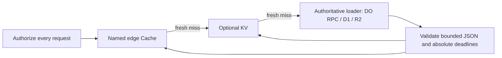

# Shared result-cache standard

Reviewed 2026-10-19 after the request for common `cache → KV → store` utilities, including cached Durable Object results. `public-edge-cache` only covers public HTTP responses; this new block covers typed internal data and keeps HTTP/auth policy with the application.

| Local evidence | Revision | Design choice |
| --- | --- | --- |
| `~/Workspace/platform/packages/playground/container/src/npm-bundle.ts`, `routeToNpmBundleCache` | `8f8ed9c2a44507490912f8631806664c724be767` | Existing Cache API → KV → R2 hierarchy and promotion. Retain layered reads, but generalize the authoritative tier to a typed loader; omit gzip, immutable asset rules, origin downloads and large-binary lanes. |
| `~/Workspace/platform/packages/playground/src/preview/preview-response-cache.ts` | same | Revision-derived keys prevent stale objects from becoming current after a content change. Retain explicit version keys, not application-specific preview routing. |
| `~/Workspace/inference-market/packages/web/src/edge_cache.ts` | `9231c25a2b7cbf9a04c428fe44324efaec3344f4` | Existing stale refresh, version memo and per-isolate pending sets. Replace app-specific HTTP refresh with a request-local loader and explicit absolute envelope deadlines; avoid sharing request I/O promises across requests. |

The implementation is original and travels with validation tests. Factory instances live for one incoming Worker request. Keys contain trusted scope, tenant, version and ordered parts, encoded as a tuple and hashed with the origin and storage namespace. Same key means same schema, visibility and loader. The parser is a synchronous decoder; loader JSON is stored, so projection/redaction must happen in the loader itself.

Fresh-only is the default. Explicit staleSeconds permits a stale candidate only until its original hard deadline, while a caught waitUntil refresh queries the store. Fresh KV beats stale edge; promotions retain age and never restart TTL. Cache failures become misses, cache writes are best-effort, and store/schema failures are never stored. Both reads and envelopes enforce a UTF-8 byte cap. The upstream query and JSON serialization still need appropriately bounded source data.

[KV consistency](https://developers.cloudflare.com/kv/concepts/how-kv-works/) remains eventual, including cached misses. [KV writes](https://developers.cloudflare.com/kv/api/write-key-value-pairs/) have a minimum expiration lifetime and per-key write restrictions. Application deadlines are therefore enforced in the envelope, even if KV retains an entry longer. Multiple requests/regions can still stampede or race writes; request-local dedupe is not a distributed lock.

Version keys are the safe invalidation mechanism: a late old-generation fill cannot overwrite a new generation. Immediate-fresh paths obtain the version from authoritative state, not a KV-cached pointer. Strict bypass skips reads, writes and dedupe and executes the store. Deleting a local cache entry plus KV is not offered as globally immediate invalidation. Same-version results may remain bounded-stale and concurrent same-version writes are not ordered; use immutable revision results or a DO-owned read model when ordering matters.

[Workers Cache inner entrypoints](https://developers.cloudflare.com/workers/cache/examples/) remain useful for HTTP-shaped computations. This block standardizes explicit JSON tiering with KV and a caller-defined store rather than replacing that platform feature. [Cache API](https://developers.cloudflare.com/workers/runtime-apis/cache/) does not implement stale directives: this utility's envelope implements the policy. Authorization, permissions, revocation and other immediately consistent security decisions never belong in this cache.

Verification:

- Default and custom namespace/payload/lifetime installs into clean `hono-d1` projects run traveling workerd tests and TypeScript.
- Tests exercise real Cache API/KV, promotion without renewal, shorter reader TTL, tenant/version/tuple/origin isolation, malformed/oversized values, errors, stale refresh, hard deadlines after slow KV, lazy cache opening, strict bypass, request overlap and old-generation races.
- `recipes/tiered-result-cache-do` renders this exact block through Kitbash's renderer and uses real SQLite DO RPC. It proves expensive projection reuse, auth on cache hits, mutation revision invalidation, tenant isolation, bypass, and mutation races between revision and summary. The DO validates expected revision; the Worker retries once then returns 409 under repeated races.
- Independent review reproduced and then verified fixes for stale candidates outliving their deadline during a slow KV read, and eager cache opening causing an unhandled rejection on bypass-only requests.

No deployment, global propagation timing, distributed collapse, authorization provider or production load benchmark is claimed. The recipe is a repository integration fixture, not a separate copy of the cache implementation.
